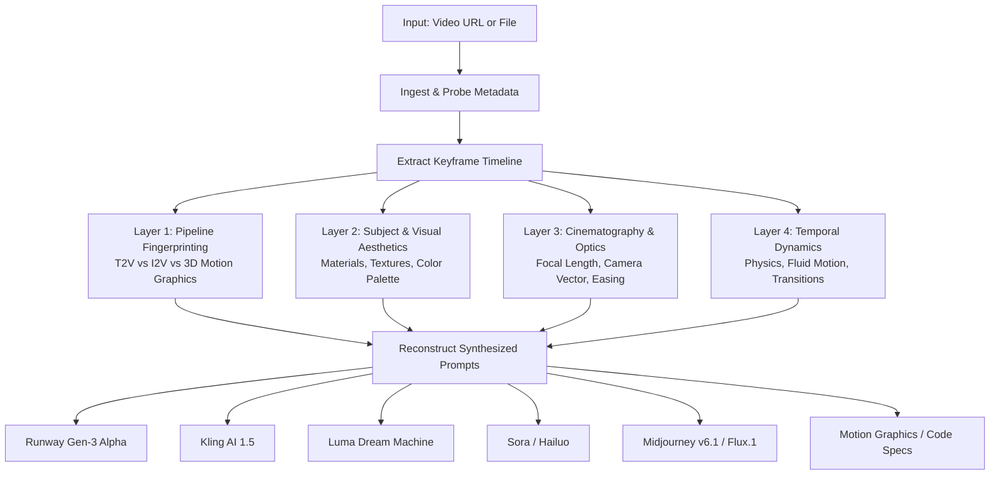

# 🎬 video-prompt-rea

> **Reverse Anything Engineering (REA) for Generative Video & Motion Graphics.**  
> Feed any video URL or file to your AI agent and extract the exact creative prompts, camera choreography, lighting setup, and generation pipeline.

[](LICENSE)
[](#antigravity)
[](#claude-code)
[](#openai-codex--chatgpt)

---

## 💡 The Problem

You see a stunning video on Twitter/X, YouTube, or TikTok — an impossible cinematic camera move, a photorealistic AI scene, or an ultra-clean tech launch demo.

You ask:
- *What prompt was used to generate this?*
- *Is this Text-to-Video (Runway / Kling / Sora) or Image-to-Video (Midjourney + Motion)?*
- *What camera lens, lighting direction, and easing curve created this specific feel?*

`video-prompt-rea` is an open-source **Agent Skill** that applies the **REA (Reverse Engineering Analysis)** methodology to deconstruct any video into reproduction-ready prompts for all major video models.

---

## ⚡ How It Works: The 4-Layer REA Framework



---

## 🚀 Quick Install

### One-line Install (macOS / Linux)

```bash
git clone https://github.com/Viniciuscarvalho/video-prompt-rea.git
cd video-prompt-rea
./install.sh
```

The installer automatically links the skill to:
- `~/.agents/skills/video-prompt-rea` (Universal agent standard, used by **Claude Code**)
- `~/.gemini/antigravity/skills/video-prompt-rea` (for **Antigravity**)

### Requirements
- **Python 3.8+** (Uses built-in standard library; no extra pip packages required!)
- **ffmpeg** (`brew install ffmpeg` on macOS, or `sudo apt install ffmpeg` on Ubuntu)
- *(Optional)* **yt-dlp** (`brew install yt-dlp`) for YouTube, Instagram, and TikTok links. Twitter/X URLs work out-of-the-box via built-in API resolution.

---

## 🎯 Usage

### In Antigravity & Claude Code
Simply paste any video link or local file in the chat:
```text
Faça o REA deste vídeo: https://x.com/shapelayer/status/2119836576750395719
```
or
```text
Reverse engineer the prompt for this video: ./my_sample.mp4
```

### In Terminal (CLI Keyframe Extraction)
You can also run the bundled extractor script standalone:
```bash
python3 scripts/extract_frames.py "https://x.com/user/status/123456789" --num-frames 6 --output-dir ./rea_output
```

---

## 📱 Multi-Platform Portability

| Platform | Setup Instructions |
| :--- | :--- |
| **Antigravity** | Automatically recognized when installed in `~/.gemini/antigravity/skills/` (handled by `./install.sh`). |
| **Claude Code** | Automatically recognized when installed in `~/.agents/skills/` (handled by `./install.sh`). |
| **Claude.ai / Projects** | Upload `SKILL.md` and files from `references/` into **Project Knowledge**. See [PORTABILITY.md](PORTABILITY.md). |
| **OpenAI Codex / ChatGPT** | Create a Custom GPT with Code Interpreter. Paste `SKILL.md` into instructions and upload references. See [PORTABILITY.md](PORTABILITY.md). |

---

## 📂 Repository Structure

```text
video-prompt-rea/
├── SKILL.md                          # Canonical Agent Skill specification & REA rules
├── README.md                         # Documentation & Guide
├── PORTABILITY.md                    # Porting guide for Claude Projects & Codex
├── LICENSE                           # MIT License
├── install.sh                        # Universal installer script
├── scripts/
│   └── extract_frames.py             # Zero-dependency video & keyframe extractor
├── references/
│   ├── model_syntax.md               # Prompt cheat sheet for Runway, Kling, Luma, Sora, I2V
│   └── cinematography_glossary.md    # Optics, lenses, lighting, and camera movement terms
└── examples/
    ├── 01-tech-launch-shapelayer.md  # Real-world deconstruction of a 4K tech launch video
    └── 02-cinematic-sci-fi.md        # Real-world deconstruction of a cinematic sci-fi shot
```

---

## 🌟 Real-World Example: @shapelayer Tech Launch Deconstruction

*(Full breakdown in [`examples/01-tech-launch-shapelayer.md`](examples/01-tech-launch-shapelayer.md))*

### Reconstructed Runway Gen-3 Alpha Prompt
```text
Slow smooth cinematic push-in: High-end space-grey laptop open on a textured oak desk, displaying a glowing white software interface. Soft warm practical lamp light highlights the edge of the keyboard, subtle dust particles floating in air, shallow depth of field, high dynamic range, 4k commercial grade, photorealistic.
```

### Reconstructed Midjourney v6.1 Hero Frame
```text
A cinematic ultra-clean close-up shot of a modern dark space-grey 16-inch laptop open on a warm rustic wooden desk, crisp illuminated display showing a minimalist modern web interface, warm glowing desk lamp casting soft golden light on the right, cool blue twilight window light from the left, shallow depth of field, sharp screen details, shot on 35mm lens, f/2.0 aperture, Apple commercial aesthetic --ar 16:9 --style raw --v 6.1
```

---

## 🤝 Contributing

Contributions are welcome! If you have optimized prompt templates for new generative video models (e.g. Wan2.1, Hunyuan, CogVideo, etc.) or cinematographic keywords, feel free to submit a Pull Request.

---

## 📄 License

MIT © [Vinicius Carvalho](https://github.com/Viniciuscarvalho)
