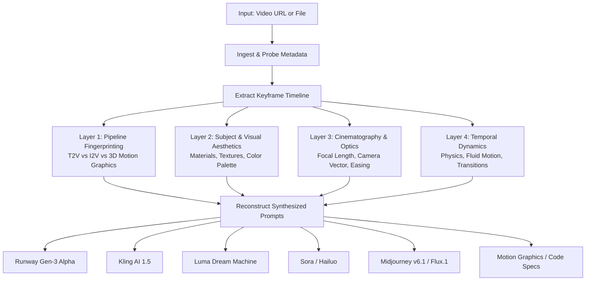

# 🎬 video-prompt-rea

> **Reverse Anything Engineering (REA) for Generative Video & Motion Graphics.**  
> Feed any video URL or file to your AI agent and extract the exact creative prompts, camera choreography, lighting setup, and generation pipeline.

[](LICENSE)
[](#-multi-platform-portability)
[](#-multi-platform-portability)
[](#-multi-platform-portability)
[](CONTRIBUTING.md)

---

## 💡 What is video-prompt-rea?

You see an inspiring video on Twitter/X, YouTube, or TikTok — an impossible cinematic drone dive, a photorealistic AI character, or an ultra-clean tech launch demo.

You ask:
- *What prompt was used to generate this?*
- *Is this Text-to-Video (Runway / Kling / Sora) or Image-to-Video (Midjourney + Motion)?*
- *What camera lens, lighting direction, and easing curve created this specific feel?*

`video-prompt-rea` is an open-source **Agent Skill** that applies the **REA (Reverse Engineering Analysis)** methodology. It automates keyframe extraction, analyzes visual composition across 4 layers, and outputs production-ready prompts tailored for every major generative video platform.

---

## 📦 What's Included

- **`SKILL.md`**: The universal Agent Skill specification, adhering to open agent conventions (progressive disclosure, YAML frontmatter, standardized tool workflows).
- **`scripts/extract_frames.py`**: A fast, zero-dependency Python script that downloads videos from Twitter/X (via native API resolution) or other platforms and extracts keyframe timelines with `ffmpeg`.
- **`references/model_syntax.md`**: Model-specific prompt engineering syntaxes for **Runway Gen-3 Alpha**, **Kling AI (v1.5)**, **Luma Dream Machine**, **Sora**, **Hailuo (Minimax)**, and **Midjourney/Flux I2V**.
- **`references/cinematography_glossary.md`**: Complete glossary of cinema terminology (camera vectors, focal lengths, aperture, volumetric lighting, color grading).
- **`install.sh`**: One-command installer that links the skill into standard agent paths (`~/.agents/skills/`) and Antigravity.
- **`PORTABILITY.md`**: Step-by-step instructions for porting this skill into **Claude Code**, **Claude.ai Projects**, and **OpenAI Custom GPTs**.
- **`examples/`**: Real-world deconstruction case studies (e.g., high-end tech product launch video).

---

## ⚡ The 4-Layer REA Framework



---

## 🚀 How to Install

### Method 1: Automatic 1-Line Install (Recommended)

```bash
git clone https://github.com/Viniciuscarvalho/video-prompt-rea.git
cd video-prompt-rea
./install.sh
```

The installer automatically detects your environment and creates symlinks in:
- `~/.agents/skills/video-prompt-rea` (Universal standard for **Claude Code** and other agents)
- `~/.gemini/antigravity/skills/video-prompt-rea` (for **Antigravity**)

### Requirements
- **Python 3.8+** (Zero pip dependencies; uses standard libraries `urllib`, `json`, `subprocess`)
- **ffmpeg** (`brew install ffmpeg` on macOS, or `sudo apt install ffmpeg` on Linux)
- *(Optional)* **yt-dlp** (`brew install yt-dlp`) for YouTube, Instagram, and TikTok links. Twitter/X URLs work out-of-the-box via built-in API resolution.

### Method 2: Manual Install

Clone or copy the directory directly into your agent's skills path:
```bash
git clone https://github.com/Viniciuscarvalho/video-prompt-rea.git ~/.agents/skills/video-prompt-rea
```

---

## 🎯 How to Use

### 1. In Antigravity or Claude Code
Once installed, simply send any video link or local video path directly in your chat:

```text
Do a video REA on this: https://x.com/shapelayer/status/2119836576750395719
```
or
```text
Faça o REA deste vídeo para extrair o prompt: ./my_video.mp4
```

The agent activates the skill, downloads/samples the video frames, analyzes each layer, and outputs structured prompts.

### 2. Standalone Terminal (CLI Extractor)
You can run the bundled Python extractor manually without an agent:

```bash
python3 scripts/extract_frames.py "https://x.com/user/status/123456789" --num-frames 6 --output-dir ./rea_output
```
This inspects resolution, duration, FPS, and extracts keyframes to `./rea_output/frames/`.

---

## 📱 Multi-Platform Portability

| Platform | Setup Instructions |
| :--- | :--- |
| **Antigravity** | Automatically recognized when installed in `~/.gemini/antigravity/skills/` (handled by `./install.sh`). |
| **Claude Code** | Automatically recognized when installed in `~/.agents/skills/` (handled by `./install.sh`). |
| **Claude.ai / Projects** | Upload `SKILL.md` and files from `references/` into **Project Knowledge**. See [PORTABILITY.md](PORTABILITY.md). |
| **OpenAI Codex / ChatGPT** | Create a Custom GPT with Code Interpreter. Paste `SKILL.md` into instructions and upload references. See [PORTABILITY.md](PORTABILITY.md). |

---

## 🌟 Real-World Example: Tech Launch Deconstruction

*(See full case study in [`examples/01-tech-launch-shapelayer.md`](examples/01-tech-launch-shapelayer.md))*

### Reconstructed Runway Gen-3 Alpha Prompt
```text
Slow smooth cinematic push-in: High-end space-grey laptop open on a textured oak desk, displaying a glowing white software interface. Soft warm practical lamp light highlights the edge of the keyboard, subtle dust particles floating in air, shallow depth of field, high dynamic range, 4k commercial grade, photorealistic.
```

### Reconstructed Midjourney v6.1 Hero Frame (for Image-to-Video)
```text
A cinematic ultra-clean close-up shot of a modern dark space-grey 16-inch laptop open on a warm rustic wooden desk, crisp illuminated display showing a minimalist modern web interface, warm glowing desk lamp casting soft golden light on the right, cool blue twilight window light from the left, shallow depth of field, sharp screen details, shot on 35mm lens, f/2.0 aperture, Apple commercial aesthetic --ar 16:9 --style raw --v 6.1
```

---

## 🤝 How to Contribute

We welcome contributions from prompt engineers, AI creators, and developers!

1. Fork the repo and create a feature branch (`git checkout -b feature/new-model`).
2. Add support for new generative video models in `references/model_syntax.md`.
3. Add cinematography terminology in `references/cinematography_glossary.md`.
4. Submit real-world case studies in `examples/`.
5. Open a Pull Request! Please read our [CONTRIBUTING.md](CONTRIBUTING.md) for full guidelines.

---

## 📄 License

MIT © 2026 [Vinicius Carvalho Marques](https://github.com/Viniciuscarvalho)
